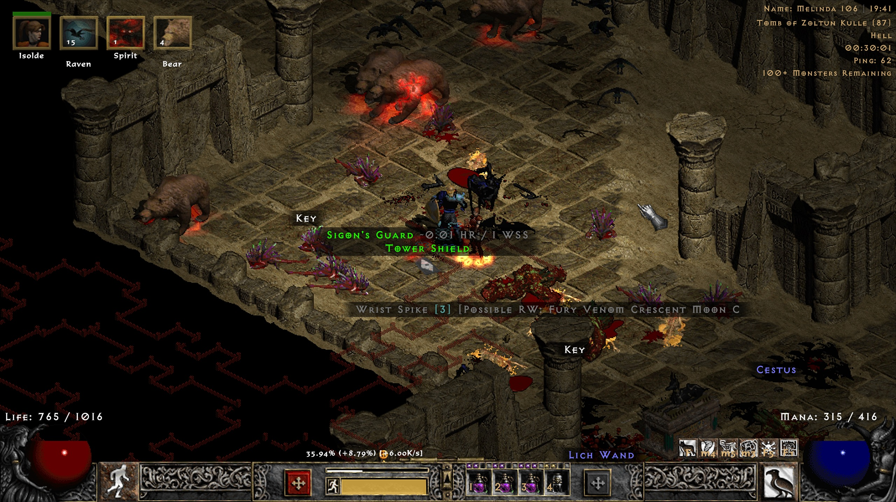
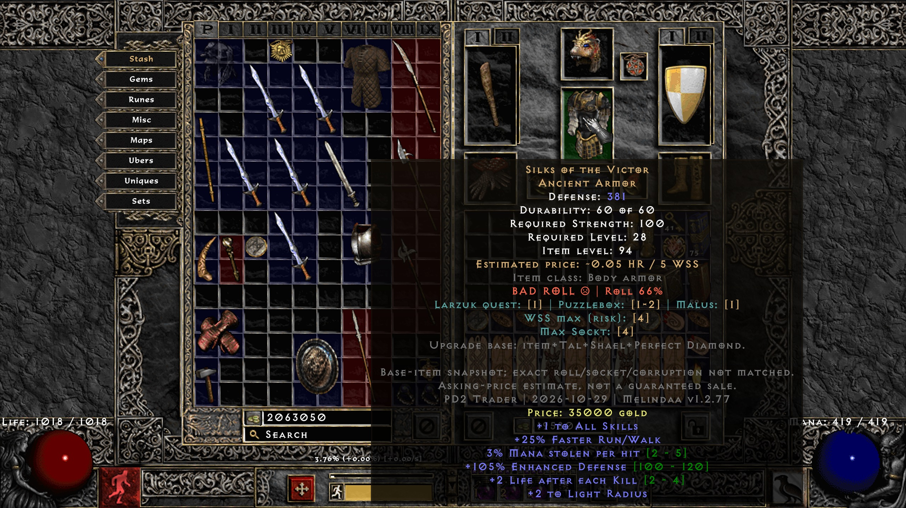
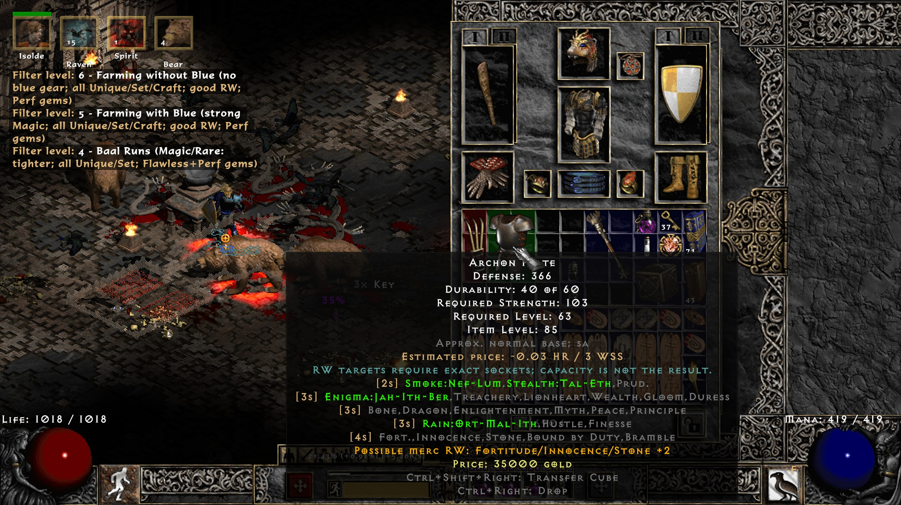
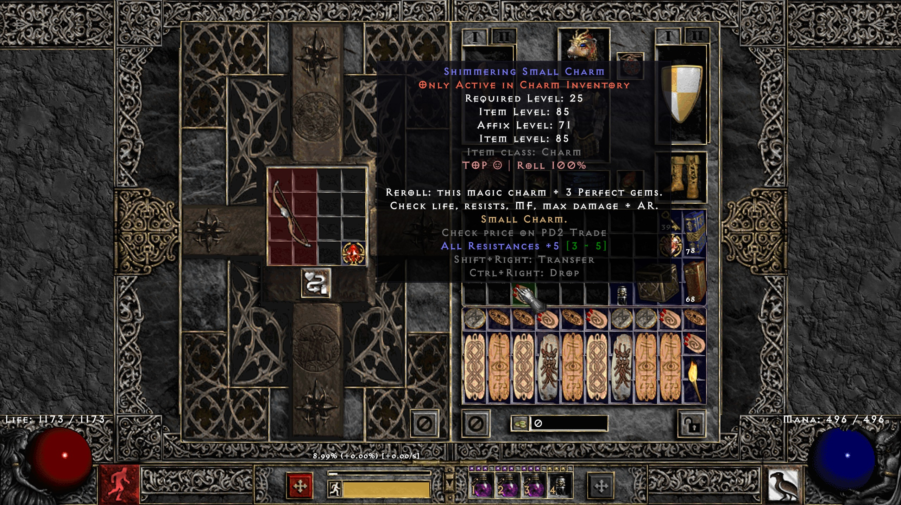

# Melindaa v1.2.105

## English

Eligible runeword bases show Perfect RW Base or Perfect Merc RW Base on the ground and in inventory. The grade ignores socket count. Merc bases require ETH and maximum enhanced damage or enhanced defense. Player bases use maximum relevant damage, defense, class skills or shield bonuses. The label grades relevant bonuses; recipe socket requirements still apply.

Project Diablo 2 loot filter with our own equipment selection, dated HR/WSS estimates, supported ROLL ratings, actual ground bonuses, crafting help and class-aware runeword recommendations.

**[Download ZIP](https://github.com/Melly87s/Melindaa/releases/latest/download/Melindaa.zip)** · **[Download RAR](https://github.com/Melly87s/Melindaa/releases/latest/download/Melindaa.rar)** · **[Changelog](./CHANGELOG.md)** · **[Full filter specification](./FILTER-SPECIFICATION.md)** · **[Screenshots](#screenshots)**

Market price refresh runs every **Friday at 12:00 (Vilnius time)**. Each successful refresh creates a new filter version and records the market data date in [Changelog](./CHANGELOG.md).

### Choose your strictness

| Level | Profile | What it shows and hides |
| --- | --- | --- |
| 1 | Normal | Shows all items. |
| 2 | Nightmare | Shows all items. |
| 3 | Hell | Broad useful Magic/Rare candidates and cautious unidentified potential. Flawless and Perfect gems. Hides Thawing, Oil and loose ID/TP scrolls. Gold 2,500+. |
| 4 | Baal Runs | Tighter equipment and plain-base selection than Hell. Flawless and Perfect gems. Useful crafting candidates can still appear. Gold 4,000+. |
| 5 | Farming with Blue | Selected craft bases, useful Magic combinations and unidentified candidates: skill + speed/cast, socket/block/life and strong weapons. Unidentified throwing knives/axes/javelins require ETH elite bases; non-ETH or normal/exceptional blue throwing drops are hidden. Useful Rare; all Unique/Set/Craft. Good advanced RW bases and CTA/HOTO exceptions. Perfect gems; gold 5,000+. |
| 6 | Farming without Blue | Hides Magic equipment and jewelry, including craft bases. All charms, jewels and PD2 specials remain. Same Rare/Set/RW selection as Farming with Blue. Perfect gems; gold 5,000+. |
| 7 | Endgame | Hides Magic equipment and jewelry, including craft bases. Stronger identified Rare and selected useful Set with supported rolls of 90%+. All Unique and Crafted items remain. Most unidentified Rare equipment remains. Runeword bases qualify with the exact sockets for a selected recipe or perfect relevant bonuses on an unsocketed base. Perfect gems and gold 10,000+. |

**Always visible at every level:** Wirt’s Leg, all Unique items for grail collecting, completed orange Crafted items, runes, charms, jewels, protected PD2 maps/materials/fragments/boss ingredients/socket tools, both Rejuvenation potions and **Antidote potions**. Inventory items remain inspectable.

Farming and Endgame show unidentified Rare equipment except ordinary Normal physical weapons. Once identified, items are selected by relevant combinations for their category. Endgame applies its 90% requirement when the filter can grade the roll reliably.

Farming/Endgame hide ordinary HP/MP potions, cold/gas/fire throwing potions and player ears. Endgame also hides ordinary chest keys. Both retain protected boss keys and special materials. Farming keeps all Set items; Endgame selects useful higher-tier candidates and handles ambiguous unidentified variants conservatively.

### Prices, rolls and help

Identified skillers show their class, skill-tree bonus and any extra modifier on the ground, e.g. **Druid +1 Shape Shifting [Life35]**.

Exact single-mod charm quotes name the roll and count matching listings, e.g. **+40 Life only; 5 listings**. Skillers with Life use a separate price sample.

Profiles through level 5 show selected Magic bases for Perfect Gem recipes. An orange **[Gem Crafting Base]** tag appears on eligible drops and in inventory tooltips. The tooltip lists the Perfect Gem and rune pairs for that item type. Cube the item with a Jewel and one of the listed pairs. The craft roll depends on the base and character level.

Item tooltips show the item’s bonuses and supported ROLL scores without “Good for” or “Useful for” class labels.

The ⚜ find marker highlights high runes, map orbs, Token essences, strong identified Rare items and high-value Unique or Set items. It appears next to the item name on the ground and in inventory.

Prices are dated **asking-price estimates**, not guaranteed sale prices. **Sellers may ask unrealistic amounts, which can distort estimates.** Supported charm/skiller/jewel/base/material/Rare/Crafted samples use a 120-hour listing/bump window. Missing supported samples mean no quote, not proof that no listings exist. Older baseline Unique/Set prices retain their original dates. NPC gold is separate.

Rune prices show a compact estimate on the ground and HR/WSS in the tooltip. El–Gul quotes average per-rune asking prices from the official PD2 market, including stack offers with a known quantity. Quotes require at least three usable listings from two sellers.

Plain unsocketed Crystal Swords show the listing count beside the asking price when the sample is small. Bases with four and five sockets use separate price samples.

ROLL describes supported variable properties, not universal build value.  Ground labels show actual identified bonuses. Socket method labels are light blue, their counts are gold, and class runeword recipes are green. Maximum socket capacity does not guarantee a socketing result. Superior bases do not use the normal-only random socket Cube recipe.

Unique and Set items use **[owned grail]** on the ground and **[Owned]** in the inventory title. The marker uses PD2's current collection state. Update timing after selling the last copy still needs in-game verification. Item level appears at the bottom of descriptions.


### Socketing methods

Eligible unsocketed items show the method's full name and socket result, capped by that base's capacity. For example, a Stealskull with maximum two sockets can show:

| Method | Result for this example | How to use |
| --- | --- | --- |
| Larzuk quest (Act 5) | 1 socket | Use the Act 5 socket quest reward at Larzuk. |
| Larzuk's Puzzlebox | 1–2 sockets | Combine the item and the named tool in the Horadric Cube. |
| Larzuk's Malus | 1 socket | Combine the item and Larzuk's Malus in the Cube; this is an item, not a quest. |

Non-Unique/Set candidates use the eligible **Larzuk's Puzzlepiece** recommendation. Results depend on quality, weapon type and capacity; do not treat the Stealskull example as the result for every item. Already-socketed items keep the compact Sockets: N/M label. Worldstone Shard corruption is a separate risky option.

### Owned Grail

**[owned grail]** on the ground and **[Owned]** in inventory indicate that PD2 counts the Unique or Set item as owned. The tooltip also shows **Owned Grail: owned** alongside supported ROLL and price details.

| Situation | What the marker means |
| --- | --- |
| Identified Unique/Set | PD2's native collection state reports that exact item variant as currently owned. |
| Unidentified Unique/Set | Marked only when PD2 confirms ownership for all variants the unknown drop could be. Ambiguous candidates remain unmarked. |
| Marker absent | Ownership was not confirmed. It is not proof you never found the item or that it is missing from every stash. |
| Sold or removed last copy | Marker clears when PD2 updates its ownership state. Immediate versus rejoin timing has not been verified in game. |
| Another owned copy remains | Marker follows PD2's remaining ownership state. Melindaa does not independently scan every stash tab. |
| Previously found, then sold | This is current ownership, not discovery history, a permanent grail achievement or a found-item counter. |
| Better duplicate rolls | Check the displayed stats/ROLL yourself. The ownership flag does not provide the stored copy's roll, so Melindaa cannot calculate an automatic upgrade percentage from it. |

**Owned Grail never hides a Unique item.** Set visibility still follows the selected strictness; this marker itself does not hide items. Ownership information requires PD2's native support and an updated, reloaded filter.

### Install or update

1. Extract the latest ZIP/RAR and copy **Melindaa.filter** into **C:\Diablo II\ProjectD2\filters\local** (adjust for your installation).
2. Choose **Item Filter Profiles → Local Filter → Melindaa.filter → Save** in the PD2 launcher.
3. Start/restart PD2, or use your configured **Reload Loot Filter** control. Check **v1.2.105** in the Horadric Cube description.
4. Change strictness with **Increase Filter Level / Decrease Filter Level** under **Esc → Options → Configure Controls**. The filter does not bind keys automatically.

## Lietuviškai

Tinkamos runeword bazės ant žemės ir inventoriuje žymimos Perfect RW Base arba Perfect Merc RW Base. Lizdų skaičius žymos nenulemia. Merc bazėms būtinas ETH ir maksimalus Enhanced Damage arba Enhanced Defense. Žaidėjo bazėms vertinami maksimalūs aktualūs damage, defense, klasės skills arba skydo bonusai. Žyma vertina aktualius bonusus; receptui reikalingi lizdai nurodomi atskirai.

Project Diablo 2 filtras su mūsų sukurta įrangos atranka, datuotais HR/WSS kainų įverčiais, palaikomais ROLL vertinimais, tikrais bonusais ant žemės, craft pagalba ir klasei pritaikytomis runeword rekomendacijomis.

**[Atsisiųsti ZIP](https://github.com/Melly87s/Melindaa/releases/latest/download/Melindaa.zip)** · **[Atsisiųsti RAR](https://github.com/Melly87s/Melindaa/releases/latest/download/Melindaa.rar)** · **[Pakeitimai](./CHANGELOG.md)** · **[Visa filtro specifikacija](./FILTER-SPECIFICATION.md)** · **[Ekrano nuotraukos](#screenshots)**

Kainos automatiškai atnaujinamos kiekvieną **penktadienį 12:00 Lietuvos laiku**. Po sėkmingo atnaujinimo išleidžiama nauja filtro versija, o rinkos duomenų data įrašoma į [pakeitimų istoriją](./CHANGELOG.md).

### Pasirink strictness lygį

| Lygis | Profilis | Ką rodo ir slepia |
| --- | --- | --- |
| 1 | Normal | Rodo visus daiktus. |
| 2 | Nightmare | Rodo visus daiktus. |
| 3 | Hell | Platesnė naudingų Magic/Rare ir neidentifikuotų kandidatų atranka. Flawless ir Perfect gemai. Slepia Thawing, Oil ir palaidus ID/TP scrolls. Gold nuo 2 500. |
| 4 | Baal Runs | Griežtesnė įrangos ir paprastų bazių atranka negu Hell. Flawless ir Perfect gemai. Naudingi craft kandidatai dar gali būti rodomi. Gold nuo 4 000. |
| 5 | Farming with Blue | Atrinktos craft bazės, naudingi Magic deriniai ir neidentifikuoti kandidatai: skill + speed/cast, socket/block/life bei stiprūs ginklai. Neidentifikuoti mėlyni throwing knives/axes/javelins paliekami tik ETH elite bazėse; ne-ETH bei normal/exceptional throwing slepiami. Naudingi Rare; visi Unique/Set/Craft. Geros pažangių RW bazės ir CTA/HOTO išimtys. Tik Perfect gemai; gold nuo 5 000. |
| 6 | Farming without Blue | Slepia Magic įrangą ir juvelyriką, įskaitant craft bazes. Visi charmai, jewels ir PD2 specialūs daiktai lieka. Rare/Set/RW atranka tokia pati kaip Farming with Blue. Perfect gemai ir gold nuo 5 000. |
| 7 | Endgame | Slepia Magic įrangą ir juvelyriką, įskaitant craft bazes. Stipresni identifikuoti Rare ir atrinkti naudingi Set su palaikomu 90 % ar aukštesniu roll. Visi Unique ir Crafted bei dauguma neidentifikuotų Rare lieka. RW bazėms tinka tikslus lizdų skaičius atrinktam receptui arba maksimalūs aktualūs bonusai, jei bazė be lizdų. Perfect gemai ir gold nuo 10 000. |

**Visuose lygiuose rodomi:** visi Unique grail kolekcijai, jau pagaminti oranžiniai Crafted, runos, charmai, jewels, saugomi PD2 mapai/medžiagos/fragmentai/boss ingredientai/socket įrankiai, abu Rejuvenation ir **Antidote potionai**. Inventoriuje daiktai neslepiami.

Farming ir Endgame rodo neidentifikuotą Rare įrangą, išskyrus paprastus Normal fizinės žalos ginklus. Identifikavus atrenkami įrangos kategorijai naudingi bonusų deriniai. Endgame 90 % riba taikoma, kai filtras gali patikimai įvertinti roll.

Farming/Endgame slepia įprastus HP/MP, cold/gas/fire throwing potionus ir player ears. Endgame papildomai slepia įprastus chest keys. Boss raktai ir saugomos medžiagos išlieka. Farming rodo visus Set; Endgame atrenka naudingus aukštesnio lygio kandidatus, o neaiškius neidentifikuotus variantus vertina atsargiai.

### Kainos, roll ir pagalba

Ant žemės prie identifikuotų skilerių rodoma klasė, įgūdžių šaka ir papildomas modas, jei yra, pvz. **Druid +1 Shape Shifting [Life35]**.

Tiksliame vieno modo charmo įvertyje rodomas modas ir sutampančių skelbimų skaičius, pvz. **+40 Life only; 5 listings**. Charmai su skillų šaka ir Life vertinami atskirai.

Profiliai iki 5 lygio imtinai rodo atrinktas mėlynas bazes Perfect gemų receptams. Oranžinė **[Gem Crafting Base]** žyma matoma ant tinkamų radinių ir inventoriaus apraše. Apraše išvardytos tam daikto tipui tinkamos Perfect gemo ir runos poros. Į Cube dėk daiktą, Jewel ir vieną iš nurodytų porų. Craft roll priklauso nuo bazės ir veikėjo lygio.

Daiktų aprašuose rodomi jų bonusai ir palaikomi ROLL įverčiai. Klasę žaidėjas pasirenka pagal matomus bonusus.

⚜ radinio žyma išskiria aukštas runas, map orbus, Token esencijas, stiprius identifikuotus Rare ir vertingus Unique ar Set daiktus. Ji rodoma prie daikto vardo ant žemės ir inventoriuje.

Kainos yra datuoti **pardavėjų prašomų kainų įverčiai**, ne garantuota pardavimo vertė. **Pardavėjai gali prašyti nerealių sumų, todėl įverčiai gali būti iškreipti.** Palaikomų charm/skiller/jewel/bazių/medžiagų/Rare/Crafted imtis naudoja 120 val. paskelbimo/atnaujinimo langą. Nepakankama imtis paliekama be kainos; tai nereiškia, kad nėra skelbimų. Senesni baziniai Unique/Set įverčiai išlaiko originalias datas. NPC gold atskiriamas.

Runų įvertis trumpai rodomas ant žemės, o apraše pateikiamas HR ir WSS. El–Gul runų įverčiai yra oficialios PD2 prekyvietės prašomų kainų vidurkiai už vieną runą. Įskaičiuojamos ir krūvelės, kurių kiekis žinomas. Reikia bent trijų tinkamų skelbimų iš dviejų pardavėjų.

Paprasto Crystal Sword be lizdų prašoma kaina rodoma su skelbimų skaičiumi, kai imtis maža. Bazėms su keturiais ar penkiais lizdais naudojamos atskiros kainų imtys.

ROLL vertina palaikomas kintamas savybes, ne universalų tinkamumą build. Ant žemės rašomi tikri identifikuoti bonusai. Socketų metodų žymos žydros, skaičiai auksiniai, o klasės runeword receptai žali. Maksimali socketų talpa negarantuoja socketinimo rezultato. Superior bazėms netaikomas tik normal kokybei skirtas random socket Cube receptas.

Unique ir Set daiktams ant žemės rodoma **[owned grail]**, o inventoriaus varde **[Owned]**. Žyma naudoja dabartinę PD2 kolekcijos turėjimo būseną. Atnaujinimo laikas pardavus paskutinę kopiją dar tikrinamas žaidime. Item level rašomas aprašymo apačioje.


### Socketų suteikimo būdai

Tinkami daiktai be socketų rodo pilną metodo pavadinimą ir šiai bazei galimą rezultatą. Pavyzdžiui, Stealskull su dviejų socketų talpa gali rodyti:

| Metodas | Rezultatas šiam pavyzdžiui | Kaip naudoti |
| --- | --- | --- |
| Larzuk quest (Act 5) | 1 socketas | Pasinaudok Act 5 socketų užduoties atlygiu pas Larzuk. |
| Larzuk's Puzzlebox | 1–2 socketai | Daiktą ir šį įrankį sudėk į Horadric Cube. |
| Larzuk's Malus | 1 socketas | Daiktą ir Larzuk's Malus sudėk į Cube; tai daiktas, ne užduotis. |

Ne Unique/Set kandidatams rekomenduojamas tinkamas **Larzuk's Puzzlepiece**. Rezultatas priklauso nuo kokybės, ginklo tipo ir talpos — Stealskull pavyzdys netinka visiems daiktams. Jau socketinti daiktai rodo trumpai Sockets: N/M. Worldstone Shard corruption yra atskiras rizikingas būdas.

### Owned Grail

**[owned grail]** ant žemės ir **[Owned]** inventoriuje žymi turimą Unique arba Set daiktą. Apraše **Owned Grail: owned** rodoma šalia ROLL ir kainos informacijos.

| Situacija | Ką reiškia žyma |
| --- | --- |
| Identifikuotas Unique/Set | PD2 native kolekcijos būsena patvirtina, kad šį konkretų variantą šiuo metu turi. |
| Neidentifikuotas Unique/Set | Žymima tik jei PD2 patvirtina visų galimų nežinomo drop variantų turėjimą. Neaiškūs kandidatai nežymimi. |
| Žymos nėra | Turėjimas nepatvirtintas. Tai neįrodo, kad niekada neradai ar kad daikto nėra nė viename stash. |
| Parduota ar pašalinta paskutinė kopija | Žyma dingsta, kai PD2 atnaujina turėjimo būseną. Ar iškart, ar po naujo prisijungimo — žaidime dar nepatikrinta. |
| Kita kopija liko | Žyma remiasi PD2 likusio turėjimo būsena. Melindaa savarankiškai neskenuoja visų stash tabų. |
| Kadaise rastas, paskui parduotas | Tai dabartinis turėjimas, ne atradimų istorija, nuolatinis grail pasiekimas ar radimų skaitiklis. |
| Geresnis naujos kopijos roll | Palygink rodomus status/ROLL pats. Turėjimo žyma negrąžina laikomos kopijos roll, todėl iš jos automatinio pagerėjimo procento apskaičiuoti negalime. |

**Owned Grail neslepia Unique daiktų.** Set rodymas priklauso nuo strictness; pati žyma daiktų neslepia. Reikia PD2 native palaikymo ir atnaujinto, perkrauto filtro.


### Diegimas ir atnaujinimas

1. Išarchyvuok naujausią ZIP/RAR ir nukopijuok **Melindaa.filter** į **C:\Diablo II\ProjectD2\filters\local** (arba savo žaidimo vietą).
2. PD2 launcheryje pasirink **Item Filter Profiles → Local Filter → Melindaa.filter → Save**.
3. Paleisk žaidimą iš naujo arba naudok savo nustatytą **Reload Loot Filter** valdymą. Kubo aprašyme patikrink **v1.2.105**.
4. Strictness keičiamas **Increase Filter Level / Decrease Filter Level**, esančiais **Esc → Options → Configure Controls**. Filtras pats klavišų nepriskiria.


### Practical runeword bases / Praktiškos runeword bazės

**English:** From Farming, recommendations use an explicit practical base/RW shortlist instead of every legal recipe. Examples: CTA Crystal Sword/Flail or staff-mod War Scepter; HOTO Flail; Enigma Mage Plate/Dusk Shroud/Archon Plate; Faith Gorgon Crossbow/selected bows; merc Insight/Infinity/Pride/Obedience on selected elite polearms/spears where legal; Fortitude/Innocence on selected armor. Insight is not recommended on caster staves. Generic Wind on arbitrary melee bases is removed; Fury targets selected claws. Orange marks Merc RW on the ground and Possible merc RW in recipe help. Socket labels use teal with gold counts. Earlier profiles include more starter recipes, but caster/merc base-purpose checks apply at every level; Insight is never recommended on caster staves, HOTO uses Flail, and Lore retains eligible starter helms. Existing quality/socket thresholds still apply: popular does not mean any roll/socket layout qualifies. The shortlist uses game compatibility and a bounded current completed-RW trade sample, not a global popularity census. No other loot-filter rules are build inputs.

**Lietuviškai:** Nuo Farming rekomendacijos remiasi konkrečiu praktinių bazės/RW derinių sąrašu, ne visais techniškai galimais receptais. Pavyzdžiai: CTA Crystal Sword/Flail arba staffmod War Scepter; HOTO Flail; Enigma Mage Plate/Dusk Shroud/Archon Plate; Faith Gorgon Crossbow/atrinktuose lankuose; merc Insight/Infinity/Pride/Obedience atrinktose elite polearm/spear bazėse, kai leidžia receptas; Fortitude/Innocence atrinktuose šarvuose. Caster staff nebesiūlomas Insight. Bendras Wind bet kokiems melee ginklams pašalintas; Fury paliekamas atrinktoms claws. Merc RW žyma ant žemės ir Possible merc RW eilutė apraše yra oranžinės. Socketų žymos žydros, o skaičiai auksiniai. Ankstesni lygiai rodo daugiau starter receptų, bet caster/merc bazių paskirtis tikrinama visur: staff nebesiūlomas Insight, HOTO siejamas su Flail, o Lore paliekamas tinkamiems starter šalmams. Kokybės/socket ribos galioja: populiari bazė nereiškia bet kokio roll/socket varianto. Sąrašas remiasi žaidimo suderinamumu ir ribota dabartinių pagamintų RW prekybos imtimi, ne visų žaidėjų populiarumo statistika. Kitų filtrų taisyklės generatoriui nenaudojamos.

Farming retains selected plain ETH elite merc weapons and low-requirement caster/buff bases even without enhanced damage; Endgame requires perfect relevant bonuses for unsocketed bases. Existing sockets qualify when they match a selected recipe.

Farming palieka atrinktus paprastus ETH elite merc ginklus ir mažų reikalavimų caster/buff bazes net be enhanced damage; Endgame maksimalių bonusų reikia bazėms be lizdų. Jei lizdai jau yra, jų skaičius turi tikti atrinktam receptui.

Ground resistance labels use Fire res / Cold res / Light res / Poison res for clarity.

Atsparumai ant žemės rašomi Fire res / Cold res / Light res / Poison res, kad nereikėtų spėlioti trumpinių.

**v1.2.71:** Endgame now accepts selected perfect unsocketed RW bases when capacity supports a practical recipe. Existing sockets must match a selected recipe exactly; bonus quality, special-drop protection and all other profiles remain unchanged. Socket capacity is not a guaranteed socketing result.

**v1.2.71:** Endgame leidžia atrinktas perf RW bazes be socketų, kai jų talpa leidžia praktišką receptą. Esami socketai turi tiksliai atitikti atrinktą receptą; bonusų kokybė, PD2 apsaugos ir kiti profiliai nepakeisti. Talpa negarantuoja socketinimo rezultato.


### Launcher metadata / Launcher metaduomenys

[`filters.json`](./filters.json) contains our single registration entry for the official PD2 list. `filter_definitions.json` describes the single `Melindaa.filter` choice. The launcher registration uses the official `name`, `url`, `author` format with the repository contents API URL. Inclusion in the official launcher list still requires PD2 approval. Item tooltips show one “Check price on PD2 Market” line for missing estimates and for baseline Unique and Set quotes. Baseline quotes still show the numeric estimate and its market data date.

[`filters.json`](./filters.json) pateikia vienintelį mūsų registracijos įrašą oficialiam PD2 sąrašui. `filter_definitions.json` aprašo vienintelį `Melindaa.filter` pasirinkimą. Launcher registracijos įrašas naudoja oficialų `name`, `url`, `author` formatą ir repozitoriumo contents API adresą. Įtraukimui į oficialų launcher sąrašą dar reikalingas PD2 patvirtinimas. Kai kainos įverčio nėra arba rodomas bazinis Unique ar Set įvertis, daikto apraše rodoma viena eilutė „Check price on PD2 Market“. Prie bazinių įverčių išlieka skaičiai ir rinkos duomenų data.

Socketing and Max Sockt share one line with the maximum in gold brackets. Larzuk quest, Puzzlebox or Puzzlepiece, and Malus results share another line. The Cube random socket range and ingredients appear when applicable. Runeword recipes mark exact requirements with gold labels such as [5s].

Socketing ir Max Sockt rodomi vienoje eilutėje, o maksimalus skaičius yra auksinis laužtiniuose skliaustuose. Larzuk užduoties, Puzzlebox arba Puzzlepiece ir Malus rezultatai rodomi kitoje eilutėje. Kai tinka Cube receptas, rodomas jo intervalas ir ingredientai. Tikslus runeword reikalavimas žymimas auksiniu skaičiumi, pvz., [5s].

Wirt’s Leg and Stamina are visible at every strictness level. Stamina stays visible at every level and is blue on the ground. Identify and Town Portal scrolls have distinct ground colors. Socket recipes have a Socketing heading. Ground labels show Possible merc RW for eligible mixed-use bases too.

Wirt’s Leg ir Stamina matomi visuose strictness lygiuose. Stamina matoma visuose lygiuose ir ant žemės rodoma mėlyna spalva. Identify ir Town Portal scrollai turi skirtingas spalvas. Socketų receptai turi antraštę Socketing. Žyma Possible merc RW rodoma ant žemės ir tinkamoms mišrios paskirties bazėms.

Hover over an eligible item in your inventory and lower the filter level to see a broader selection of compatible runewords. From Farming onward, the tooltip focuses on advanced recipes. Runeword names are gold and show the rune order. Bind Increase Filter Level and Decrease Filter Level to Numpad + and − to compare recommendations while hovering.

Užvesk pelę ant tinkamos bazės inventoriuje ir sumažink filtro griežtumą, kad pamatytum daugiau jai tinkamų runeword receptų. Nuo Farming rodomi atrinkti pažangesni receptai. Runeword pavadinimas auksinis, o šalia jo rodoma runų seka. Priskirk Increase Filter Level ir Decrease Filter Level prie Numpad + ir −, kad galėtum palyginti receptus laikydamas pelę ant daikto.

### PD2 item guides / PD2 daiktų paskirtis

Hover over essences, boss materials, map orbs and other supported PD2 consumables in your inventory or stash to see their use, Cube ingredients and confirmed ways to obtain them.

Inventoriuje ar stash užvedus pelę ant esencijų, boss medžiagų, mapų orbų ar kitų palaikomų PD2 vartojamų daiktų, aprašyme rodoma jų paskirtis, Cube ingredientai ir patvirtinti gavimo būdai.

### Worldstone Shard

The Worldstone Shard tooltip uses gray text for corruption guidance. The listed bonuses and map effects are a few of the possible outcomes. The tooltip also explains when gear can gain sockets and the risk of turning it into a random Rare.

Worldstone Shard paaiškinimai rodomi pilkai. Išvardyti bonusai ir mapų efektai yra tik keli iš daugelio galimų rezultatų. Apraše taip pat paaiškinta, kada įranga gali gauti socketų ir kada gali virsti atsitiktiniu Rare daiktu.

## Screenshots

Examples from earlier Melindaa builds. The prices shown are dated estimates.

Ankstesnių „Melindaa“ versijų ekrano nuotraukos. Rodomos kainos yra tų versijų įverčiai.

### Loot on the ground / Daiktai ant žemės

See the HR/WSS estimate beside Sigon’s Guard and the socket count and runeword suggestions beside Wrist Spike.

Šalia „Sigon’s Guard“ matyti HR/WSS įvertis, o šalia „Wrist Spike“ – socketų skaičius ir galimi runewordai.



### Estimated price and ROLL / Kainos įvertis ir ROLL

Silks of the Victor shows its estimated market value, 66% ROLL, and socketing options in one tooltip.

„Silks of the Victor“ apraše kartu matyti rinkos kainos įvertis, 66 % ROLL ir socketinimo būdai.



### Runeword guide / Runeword pagalba

Archon Plate shows Enigma’s three-socket requirement and Jah–Ith–Ber rune order. Mercenary options are highlighted separately.

„Archon Plate“ apraše matyti, kad „Enigma“ reikia trijų socketų ir runų Jah–Ith–Ber. Variantai mercui pažymėti atskirai.



### Charm ROLL and reroll recipe / Charmo ROLL ir perridenimas

Shimmering Small Charm shows 100% ROLL alongside +5 All Resistances on a 3–5 range and the three-Perfect-Gem reroll recipe.

„Shimmering Small Charm“ turi 100 % ROLL, nes gavo +5 visų atsparumų iš galimo 3–5 intervalo. Apačioje matyti perridenimo receptas su trimis „Perfect Gems“.



## PD2 Launcher registration

Copy this entry into the official PD2 `filters.json` when submitting a pull request. Pateikdami „pull request“, nukopijuokite šį įrašą į oficialų PD2 `filters.json`.

```json
{"name": "Melindaa", "url": "https://api.github.com/repos/Melly87s/Melindaa/contents", "author": "Melindaa"}
```

## How Melindaa started

We started with Steven Obst’s PD2 Price Filter tool and adapted rules from Kassahi’s loot filter. From v1.2.46, we rebuilt the selection rules with our own generator. Today’s Melindaa is an original filter with our own item-selection logic and HR/WSS pricing pipeline, using PD2 market data.

### Kaip atsirado „Melindaa“

Pradžioje rėmėmės Steveno Obsto „PD2 Price Filter“ įrankiu ir pritaikėme Kassahi filtro taisykles. Nuo v1.2.46 daiktų atrankos taisykles perrašėme savo generatoriumi. Dabartinė „Melindaa“ yra originalus filtras su mūsų sukurta daiktų atranka ir HR/WSS kainų sistema, kuri remiasi PD2 rinkos duomenimis.
